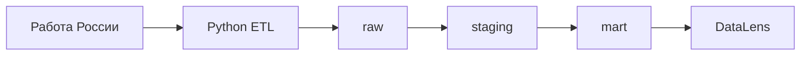

# IT Job Market Dashboard

Проект показывает, как превратить открытые данные о российских IT-вакансиях в витрины PostgreSQL для анализа спроса, зарплат и географии найма.

**Источник:** [открытый API «Работа России»](https://trudvsem.ru/opendata/api). **BI:** [дашборд DataLens в разработке](https://datalens.ru/0flqwkmwzvbuj-rynok-it-vakansiy).

## Что анализируем

- Сколько вакансий из выборки было опубликовано по неделям и какие роли встречаются чаще.
- Как отличаются оценочные медианы зарплат по ролям, опыту и локациям, и сколько вакансий раскрывают вилку.
- Какие работодатели чаще встречаются в выборке и где явно указана удалённая работа.

## Архитектура




В `raw` хранятся исходные JSON и отображение внешнего UUID во внутренний идентификатор. В `staging` находятся типизированные вакансии и связи с ролями и навыками. `mart` содержит представления для DataLens. Доступ BI-роли ограничен чтением этих представлений.

| Файл | Назначение |
| --- | --- |
| [sql/01_init.sql](sql/01_init.sql) | Схемы, таблицы и витрины PostgreSQL |
| [etl/load_trudvsem.py](etl/load_trudvsem.py) | Пагинация API, отбор по заголовку, дедупликация по UUID и транзакционная загрузка |
| [sql/02_analytics.sql](sql/02_analytics.sql) | Десять запросов с CTE, оконными функциями и медианами |
| [sql/stress_test.sql](sql/stress_test.sql) | Воспроизводимый стресс-тест с откатом |

## Воспроизведение

Нужны Python 3.11+, PostgreSQL и клиент `psql`. Настройте стандартные переменные PostgreSQL `PGHOST`, `PGPORT`, `PGDATABASE`, `PGUSER` и пароль через локальный файл паролей psql. Для облачного PostgreSQL задайте подходящий режим TLS.

```bash
psql -X -v ON_ERROR_STOP=1 -f sql/01_init.sql
python3 etl/load_trudvsem.py --dry-run --max-pages 1
python3 etl/load_trudvsem.py
psql -X -v ON_ERROR_STOP=1 -f sql/02_analytics.sql
```

Для тестового прогона используйте `psql -X -v ON_ERROR_STOP=1 -f sql/stress_test.sql`. Запускайте его в выделенной тестовой базе. Откат удаляет тестовые строки, а последовательность внутренних идентификаторов может продвинуться.

## Подтверждённые результаты

- Пробная загрузка от **24 ноября 2026 года по Москве**. В предпросмотре DataLens проверена одна реальная вакансия с вилкой 30–40 тыс. ₽.
- На Neon проверена загрузка 50 000 синтетических вакансий. Повтор той же партии в транзакции добавил 0 строк. Контрольная медиана 26 500,50 ₽ совпала, после отката в таблице осталось 0 тестовых строк.
- Полная выгрузка, выводы о рынке и финальная визуализация пока в работе.

## Ограничения

Выборка зависит от покрытия портала и поисковых фраз. Дата публикации описывает опубликованные вакансии, обнаруженные в выборке, а изменение общего числа открытых вакансий требует регулярных снимков. Медиана оценивается по серединам указанных вилок или единственной доступной границе. В выводах нужно указывать число вакансий, по которым известна зарплата. Отсутствие признака удалёнки означает неизвестный формат. Адрес источника может содержать информацию точнее названия населённого пункта. Навыки пока не извлекаются.

Профиль автора: [GitHub](https://github.com/x7inferno7x).
